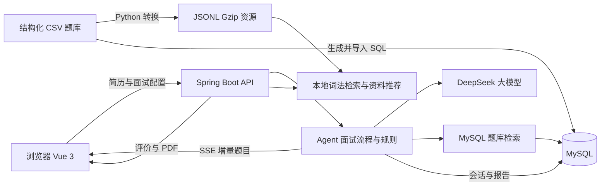

# AI Interview Agent

基于 LLM Agent、知识库检索和 SSE 流式交互的 AI 模拟面试系统。围绕“简历准备 → 岗位面试 → 评估反馈 → 针对性复习”提供应用原型，适合学习大模型应用集成与 RAG 工程实现。

后端使用 Java 17 / Spring Boot，前端使用 Vue 3 / TypeScript。默认模型客户端为 DeepSeek，当前知识检索采用词法匹配与结构化筛选。

An AI mock interview application with LLM-guided dialogue, lexical RAG, streaming questions, resume parsing, and interview feedback.

## 功能

- **简历解析**：提取文字型 PDF、DOCX 内容，调用模型生成结构化简历数据。
- **动态面试**：结合岗位、简历、难度和历史问答生成问题，按回答情况追问或切换知识点，持久化会话状态。
- **流式输出**：通过 SSE 推送生成中的下一道题，对结构化模型输出进行增量字段提取。
- **知识库检索**：接入 20,000 条面试问答，支持岗位与难度过滤、加权词法排序、Top-K、来源标识和学习资料推荐。
- **题库练习**：按岗位浏览问题与参考答案，查看知识关系图和学习资源。
- **面试反馈**：生成综合与逐题评价，查看历史记录，导出 PDF 报告。

## 使用流程

1. 上传或填写简历，确认目标岗位与面试配置。
2. 完成自我介绍，进入多轮文字面试。
3. 根据面试官追问继续作答，也可选择知识库题目练习。
4. 查看评价、参考资料和薄弱点建议，按需导出报告。

## 实现要点

### 可控的面试流程

模型负责回答判断和题目生成，Java 规则负责题目数量、追问次数、无效回答处理及结束条件。会话状态存储在 MySQL 中，可在重新进入页面时恢复。

### 两条知识检索链路

| 链路 | 实现方式 | 无命中时的行为 |
| --- | --- | --- |
| 指定题库面试 | MySQL 关键词查询，结合岗位技术词和难度优先筛选，拼接参考上下文 | 可回退为指定题库内取样 |
| 本地知识检索与推荐 | 加载 CSV 派生的 JSONL 资源，提取中英文检索词，按相关性加权评分，以优先队列保留 Top-K | 低于相关性阈值时返回空结果 |

本地检索保留来源行号，最多返回 5 条结果，并限制上下文长度。工具接口供业务调用；当前未实现由模型自主触发的原生 Function Calling、MCP 或多 Agent 协作。

### 结构化结果与逐步展示

模型返回 JSON 决策时，后端可在完整 JSON 尚未结束前提取 `nextQuestion` 字符串，通过 SSE 推送给前端，兼顾结构化决策与题目逐步展示。

## 系统结构



简历解析和面试决策调用外部模型，知识检索由本地代码执行。MySQL 题库检索与本地词法推荐是两条独立链路，使用不同的筛选和回退策略。

## 数据集

仓库附带一份结构化面试问答 CSV，以及后端可直接加载的压缩知识资源。源 CSV 与生成脚本一并保留，便于复现实验和扩展题库。

| 项目 | 内容 |
| --- | --- |
| 问答数量 | 20,000 条，行号和问题均唯一，问题与回答字段无空值 |
| 原始岗位分类 | 18 类，覆盖通用面试、后端开发、产品经理、数据分析等 |
| 难度 | basic 6,250 条；intermediate 11,124 条；advanced 2,626 条 |
| 原始字段 | 16 个，含来源、问题、答案、岗位、技能、场景、题型和检索文本 |
| 本地检索岗位 | 归一化为后端开发、前端开发、产品经理、通用面试和其他岗位 |
| 数据位置 | `data/knowledge/interview_rag_structured_v1.csv` |

这些统计说明数据结构与覆盖范围，不代表题目正确率或检索效果。字段定义、完整岗位分布、生成方式和数据使用边界见 [数据集说明](data/knowledge/README.md)。

## 技术栈

| 部分 | 技术 |
| --- | --- |
| 后端 | Java 17、Spring Boot 3.3.3、MyBatis-Plus、MySQL |
| 前端 | Vue 3、TypeScript、Vite、Element Plus、Pinia、ECharts |
| 模型接入 | DeepSeek API；另保留 DashScope 客户端实现 |
| 数据处理 | Python 标准库、CSV、JSONL、Gzip |
| 文件处理 | Apache PDFBox、Apache POI |
| 交互 | REST API、SSE；另保留媒体 WebSocket 通道 |

## 目录

```text
.
├── frontend/                 # Vue 应用、前端资源和依赖锁文件
├── src/main/java/           # 后端业务、模型客户端和检索服务
├── src/main/resources/      # 环境变量配置、本地知识资源
├── src/test/java/           # 原有测试代码
├── scripts/                 # 题库转换与 SQL 生成脚本
├── sql/                     # 初始化、历史迁移和示例资源
├── data/knowledge/          # CSV 题库与数据说明
├── docs/                    # 启动步骤、API 与验证记录
├── .env.example             # 后端环境变量清单
└── pom.xml
```

## 本地启动

### 环境

- JDK 17 或更高版本，编译目标为 Java 17。
- Maven 3.9 或更高版本。
- Node.js 22.12 或更高版本，npm。
- MySQL 8。
- Python 3.10 或更高版本，仅数据脚本需要，无额外 pip 依赖。
- 可用的 DeepSeek API Key。纯知识检索不消耗模型调用，启动应用仍需要数据库。

### 1 初始化演示数据库

如果原项目已在这台电脑正常运行，可以复用原数据库，直接从第 2 步开始。启动前确认 MySQL 服务正在运行。已有数据库不要重复执行下面的 `init.sql`，它会重建并清空业务表。

首次使用全新的演示数据库时，才执行本节步骤。

先执行：

```sh
python scripts/gen_knowledge_chunk_sql.py
mysql --default-character-set=utf8mb4 -u root -p
```

在项目根目录启动的 MySQL 客户端中，按顺序执行：

```sql
SOURCE sql/init.sql;
SOURCE sql/week2_integration.sql;
SOURCE sql/add_reference_answer.sql;
SOURCE sql/add_report_question_reviews.sql;
SOURCE sql/knowledge_chunk_data.sql;
SOURCE sql/knowledge_graph_data.sql;
SOURCE sql/init_learning_resources.sql;
```

`init.sql` 会重建业务表，部分种子脚本会清空对应表，只用于全新的演示库；不要在已有业务数据库直接执行。历史迁移与数据生成另见 [启动说明](docs/SETUP.md)。

### 2 配置并启动后端

`.env.example` 是变量清单，**Spring Boot 不会自动读取 `.env`**。请在终端或 IDE 运行配置中设置变量。

Windows 用户打开**第一个 PowerShell 窗口**，启动后端。以下路径对应桌面的精简副本；若项目放在其他位置，请修改 `cd` 路径。将密码和密钥替换为自己的实际值：

```powershell
cd "$env:USERPROFILE\Desktop\ai-interview-agent-opensource"

$env:DB_USERNAME = "root"
$env:DB_PASSWORD = "你的本地数据库密码"
$env:DEEPSEEK_API_KEY = "你的API密钥"

mvn "-Dmaven.test.skip=true" spring-boot:run
```

看到 `Started AiInterviewSystemApplication` 表示后端启动成功。命令暂时跳过与当前接口不同步的旧测试。环境变量仅对当前终端及其启动的进程生效，重新打开终端后需要再次设置。

Bash 示例：

```bash
export DB_USERNAME="root"
export DB_PASSWORD="你的本地数据库密码"
export DEEPSEEK_API_KEY="你的API密钥"
mvn "-Dmaven.test.skip=true" spring-boot:run
```

后端默认地址：`http://localhost:8080/api`。密码和第三方凭证均从环境变量读取，无需写入配置文件。

### 3 启动前端

Windows 用户打开**第二个 PowerShell 窗口**，启动前端：

```powershell
cd "$env:USERPROFILE\Desktop\ai-interview-agent-opensource\frontend"

npm.cmd ci
npm.cmd run dev
```

`npm.cmd ci` 用于首次安装依赖；之后依赖未变化时，直接执行 `npm.cmd run dev` 即可。使用 `npm.cmd` 可避免 PowerShell 对 npm 脚本的执行策略限制。

其他终端可在项目根目录执行：

```sh
cd frontend
npm ci
npm run dev
```

在浏览器访问 Vite 输出的本地地址，通常为 [http://localhost:5173](http://localhost:5173)。如果端口被占用，以终端显示的地址为准。

两个终端窗口都要保持打开；停止服务时，在对应窗口按 `Ctrl+C`。后续再次使用时，分别启动后端和前端即可，无需重新初始化数据库。

开发代理默认把 `/api` 转发到 `http://localhost:8080`。自定义目标可复制 `frontend/.env.example` 为 `frontend/.env` 后修改。

### 构建与验证

```sh
npm --prefix frontend ci
npm --prefix frontend run build
mvn "-Dmaven.test.skip=true" package
```

后端产物为 `target/ai_interview_system-0.0.1-SNAPSHOT.jar`。部分原有测试与当前接口不同步，`mvn test` 会在测试编译阶段失败，打包命令暂时跳过测试编译和执行。打包成功不等于完整测试通过，详见 [验证记录](docs/VERIFICATION.md)。

## API 示例

验证本地题库统计与检索：

```sh
curl "http://localhost:8080/api/knowledge/interview-rag/stats"
curl --get "http://localhost:8080/api/knowledge/interview-rag/search" --data-urlencode "targetRole=后端开发" --data-urlencode "difficulty=MEDIUM" --data-urlencode "query=Java 线程池" --data-urlencode "topK=3"
```

业务入口和 SSE 事件格式见 [API 说明](docs/API.md)。

## 当前边界

- 当前未实现 Embedding、向量数据库、BM25、混合检索或重排模型。
- 鉴权拦截器默认放行，用户模块为原型实现。请在本地或受控环境演示；互联网部署前需要完善身份验证、密码存储与访问控制。
- 媒体能力接口声明正式服务端 ASR/TTS 和视频上传不可用；另保留可选讯飞识别适配，不能视为完整端到端语音或视频面试。
- 扫描件 PDF 需要 OCR；当前提取器主要支持文字型 PDF 和 DOCX。
- 模型输出用于面试练习参考，不代替真实招聘评价。

## 数据与许可证

项目代码和项目文档采用 [MIT License](LICENSE)。第三方依赖遵守各自许可证；题库、派生数据与图像资源的使用说明见 [数据集说明](data/knowledge/README.md)，不要把代码许可证视为对所有外部内容的授权。

## 后续方向

- 按当前接口修订失配的旧测试，补充可复现的集成验证。
- 在词法检索基线上实验 Embedding、向量检索、混合召回与重排。
- 构建固定评测集，记录命中、无答案查询和失败样例，验证检索策略改动。
- 完善鉴权与访问控制，再考虑公开服务部署。

以上为后续计划，当前实现范围以功能和边界说明为准。
